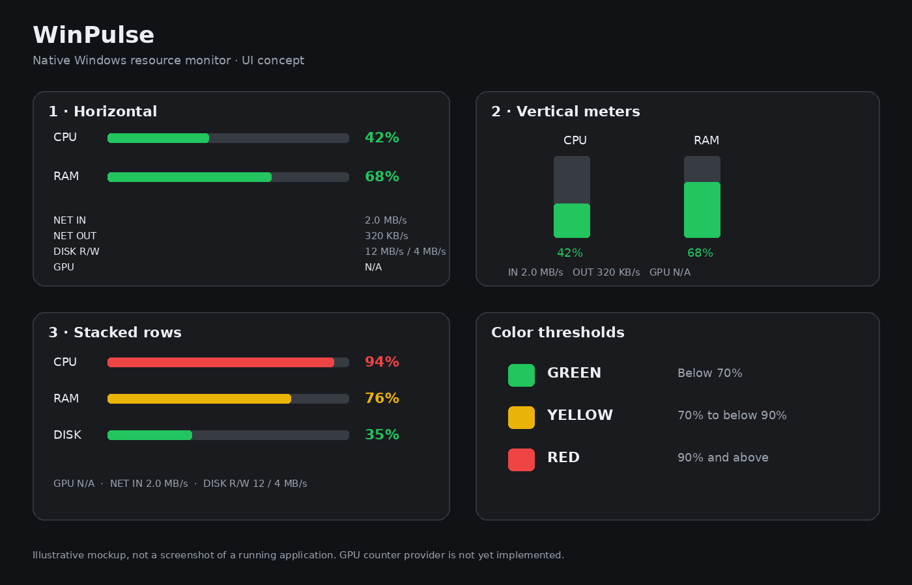

# WinPulse

WinPulse is a lightweight native Windows floating system-resource widget written in Rust. It uses Win32/GDI for its UI and small, per-resource modules for network, disk, and GPU metrics. It is a floating always-on-top window, not a native taskbar toolbar.

## Features

- Three selectable layouts: horizontal, vertical meters, and stacked rows.
- CPU and physical RAM utilization, refreshed approximately once per second.
- Network receive/transmit throughput across detected interfaces.
- Disk read/write activity enabled by default.
- Optional aggregate disk-space indicator, disabled by default.
- GPU indicator visible by default. It displays a real percentage only when a provider returns one; otherwise it explicitly displays `N/A`.
- Shared utilization colors: green below 70%, yellow from 70% to below 90%, and red at 90% or above.
- Right-click menu for layout selection, GPU visibility, disk-space visibility, and exit.
- Size-focused release settings: `opt-level = "z"`, LTO, one codegen unit, panic abort, and symbol stripping.

> **GPU limitation:** this revision deliberately reports `GPU N/A`. The provider module is isolated and returns unavailable rather than fabricating 0%. A Windows PDH GPU Engine counter provider still needs to be implemented and validated against supported Windows/driver configurations before GPU percentages can be advertised as available.

## UI preview

The image below is an illustrative mockup, not a screenshot of a running build. The actual values and GPU availability depend on the host system.



## Layouts

### Horizontal (default)

```text
+-----------------------------------------------+
| CPU     [████████░░░░░░░░░░░░]          42%   |
| RAM     [████████████░░░░░░░░]          68%   |
| NET IN  [track]                         2 MB/s|
| NET OUT [track]                       320 KB/s|
| DISK R/W [track]                  12 MB/s/4 MB/s|
| GPU     [track]                          N/A  |
+-----------------------------------------------+
```

### Vertical meters

```text
+---------------------------+
|       CPU        RAM      |
|      [██░]      [███]     |
|       42%         68%     |
| IN  2 MB/s                |
| OUT 320 KB/s              |
| DISK R/W 12 MB/s/4 MB/s   |
| GPU N/A                   |
+---------------------------+
```

### Stacked rows

```text
+-----------------------------------------------+
| CPU     [████████░░░░░░░░░░░░]          42%   |
| RAM     [████████████░░░░░░░░]          68%   |
| ... network and disk activity ...             |
+-----------------------------------------------+
```

These diagrams are wireframes; the fill, readings, and optional disk-space row depend on current data and menu settings.

## Color policy

| Utilization | Color | Meaning |
|---|---|---|
| Below 70% | Green `#22C55E` | Normal |
| 70% to below 90% | Yellow `#EAB308` | Elevated |
| 90% and above | Red `#EF4444` | High |

The threshold applies to utilization percentages (CPU, RAM, and disk-space usage). Network throughput and disk read/write rates are shown as rates and are not assigned utilization colors. High utilization is an attention cue, not necessarily a fault.

## Interaction

- **Left-click and drag:** move the borderless widget.
- **Right-click:** open the context menu.
- **Choose a layout:** switch layout directly.
- **Show GPU:** toggles the GPU row; when shown without a working provider it reads `N/A`.
- **Show disk space:** toggles aggregate used-space percentage across detected disks. It is off by default; drive-specific selection is not implemented yet.
- **Exit WinPulse:** close the application.

Preferences are not persisted between launches. The widget opens near the bottom-right of the primary display's work area.

## Metric details and limitations

- **CPU:** system-wide utilization calculated from `GetSystemTimes` deltas. The first sample establishes a baseline.
- **RAM:** Windows physical-memory load from `GlobalMemoryStatusEx`.
- **Network:** received/transmitted bytes are sampled from detected interfaces and converted to approximate per-second rates. Virtual interfaces can affect totals on some systems.
- **Disk activity:** read/write byte deltas from detected disks, refreshed on the same approximately one-second timer. Disk activity is enabled by default.
- **Disk space:** optional aggregate used/total capacity across detected disks. Per-drive selection and configurable thresholds remain future work.
- **GPU:** currently unavailable (`N/A`). A PDH `GPU Engine` counter provider is a known outstanding implementation item; no fake value is shown.
- Metrics may briefly show zero rates during initial baseline collection or when the system is idle.
- High-DPI behavior, multi-monitor placement, persisted preferences, and runtime behavior have not been fully validated in this environment.

## Build from source

Requirements: Windows 10 or later, Rust stable with the `x86_64-pc-windows-msvc` target, Visual Studio C++ build tools, and the Windows SDK.

```powershell
cargo fmt --all -- --check
cargo check --release --target x86_64-pc-windows-msvc
cargo build --release --target x86_64-pc-windows-msvc
```

Output: `target/x86_64-pc-windows-msvc/release/winpulse.exe`.

Commit `Cargo.lock` after generating it with Cargo to make dependency resolution reproducible. The optimized release profile prioritizes executable size; actual size and resource use must be measured from a successful build and runtime test.

## Project structure

```text
WinPulse/
├── .github/workflows/windows-build.yml
├── assets/winpulse-ui-showcase.png
├── src/
│   ├── main.rs
│   └── monitoring/
│       ├── mod.rs
│       ├── network.rs
│       ├── disk.rs
│       └── gpu.rs
├── Cargo.toml
├── DESIGN.md
├── LICENSE
└── README.md
```

## GitHub Actions

The workflow checks formatting and builds the Windows x64 executable. Review the Actions logs for the actual result. Do not publish a release until Windows compilation and smoke tests pass, especially the metrics and GPU fallback behavior.

## License

MIT. See [LICENSE](LICENSE).
